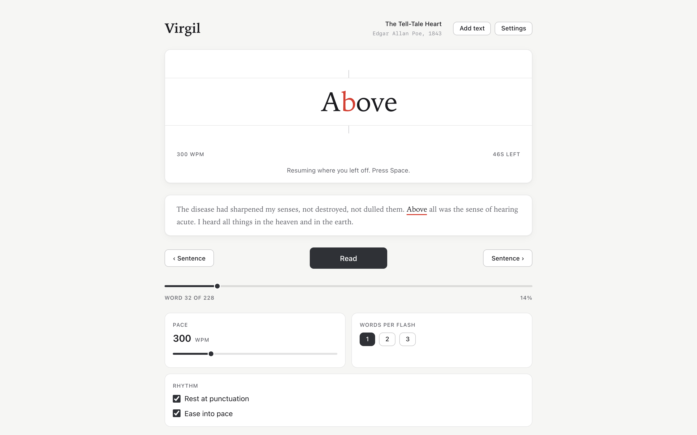
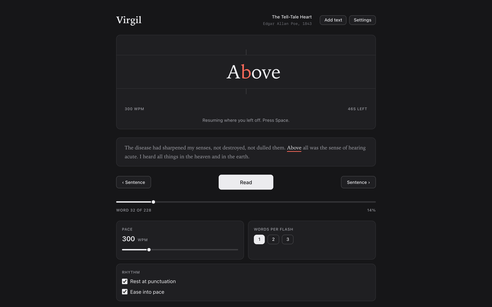
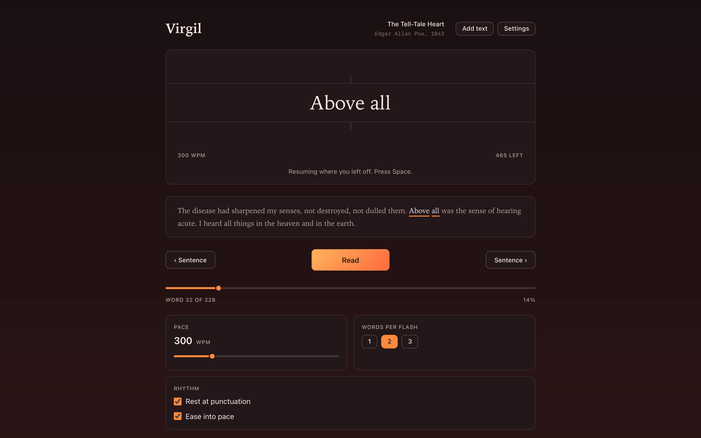
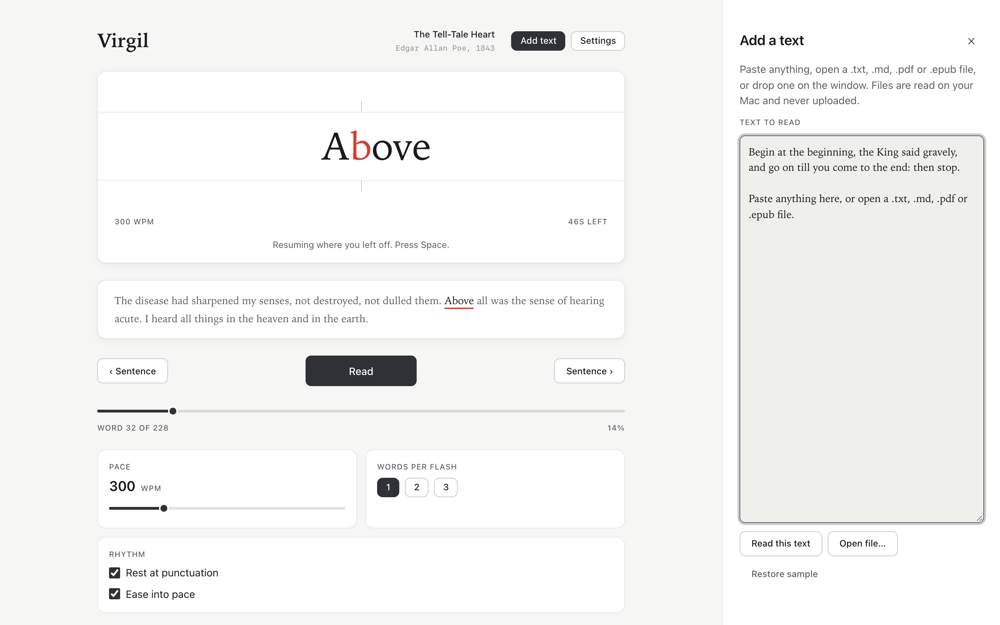
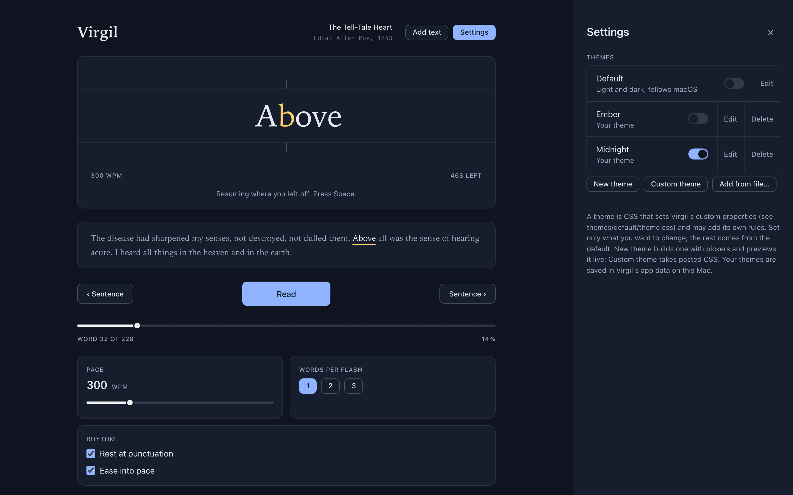
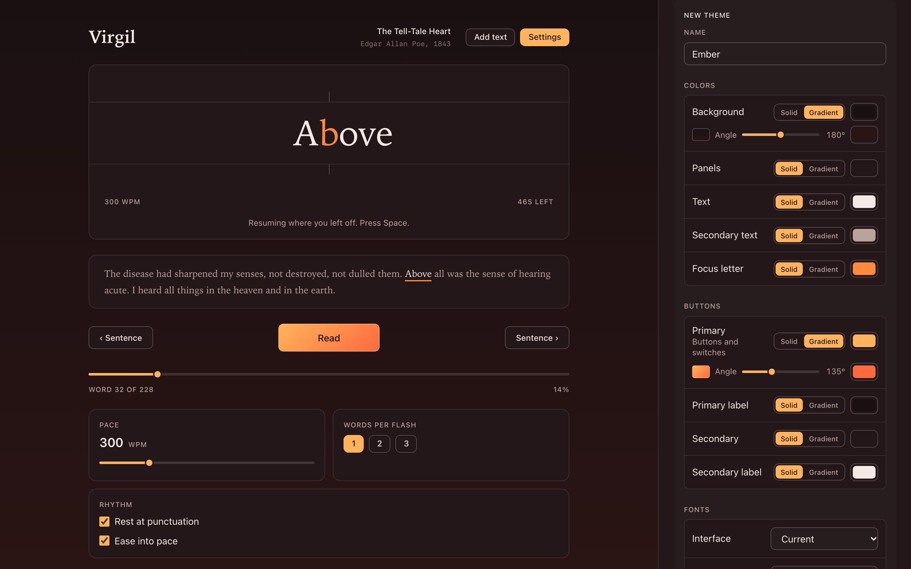
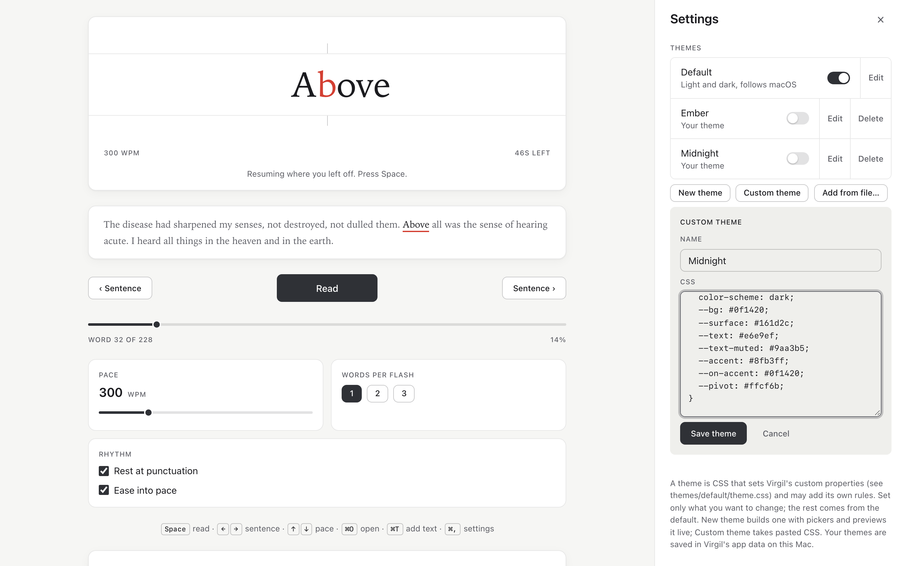
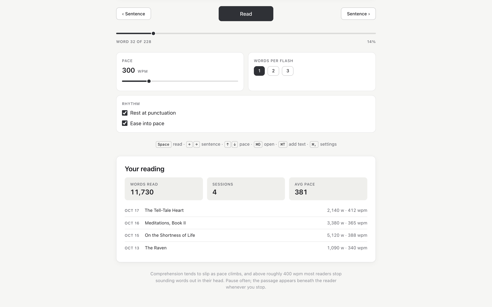

# Virgil

An open-source RSVP speed reader for macOS. Virgil shows a text one word at a time in a fixed spot, with the letter your eye should land on marked in color, so you read without moving your eyes across a page.



- **Paste text** or **open a file** from the Add a text side panel (⌘T): `.txt`, `.md`, `.pdf` or `.epub` (or drop one on the window). Files are converted on your Mac and never uploaded.
- Pace from 100 to 1000 words per minute, one to three words per flash, pauses at punctuation and paragraph breaks, and an ease-in at the start.
- **Read aloud** with the Mac's own voices, the reader following each spoken word; download a Premium voice in System Settings for a natural one.
- The passage around the current word stays in view; click a word there to jump to it. Books and Markdown get a chapter menu.
- Virgil keeps your last five texts and where you stopped in each, plus a short history of your sessions.
- Four looks (Default, Paper, Night, High contrast), each light and dark, a theme builder, and a System / Light / Dark switch.
- Native and lightweight: built with [Tauri](https://tauri.app).

<table>
  <tr>
    <td width="50%"><br><sub>Light and dark follow macOS.</sub></td>
    <td width="50%"><br><sub>One to three words per flash.</sub></td>
  </tr>
  <tr>
    <td><br><sub>Paste text or open a file (⌘T).</sub></td>
    <td><br><sub>Switch themes in Settings (⌘,).</sub></td>
  </tr>
  <tr>
    <td><br><sub>Build a theme with pickers, previewed live.</sub></td>
    <td><br><sub>Or paste your own CSS.</sub></td>
  </tr>
  <tr>
    <td colspan="2"><br><sub>Your reading history stays on your Mac.</sub></td>
  </tr>
</table>

Coming next: read-aloud with word-synced voices (macOS system voices, a local Kokoro model, or ElevenLabs), and a Converse mode for asking about what you're reading. See [docs/ARCHITECTURE.md](docs/ARCHITECTURE.md).

## Install

1. Download the latest `Virgil_x.y.z_universal.dmg` from [Releases](https://github.com/javontaymcelroy/virgil/releases). It runs on Apple Silicon and Intel Macs, macOS 11 or later.
2. Open the `.dmg` and drag **Virgil** into **Applications**.
3. Open Virgil. Releases are signed with an Apple Developer ID and notarized by Apple, so it opens like any other app.

   If macOS says Virgil "can't be opened", you have an unsigned build (one you built yourself without signing, or a release whose notes say it isn't signed). Open it once this way: in Applications, **right-click (or Control-click) Virgil → Open**, then click **Open**. On macOS 15 (Sequoia) and later, if there's no Open button, try opening Virgil once, then go to **System Settings → Privacy & Security** and click **Open Anyway** next to the message about Virgil. From then on it opens normally.

## How to use

1. **Add a text.** Click **Add text** (⌘T) and paste into the box, then click **Read this text**. Or click **Open file…** (⌘O), or drop a `.txt`, `.md`, `.pdf` or `.epub` file onto the window. Pressing ⌘V anywhere outside a text field reads whatever is on the clipboard.
2. **Read.** Press **Space** (or click the reader) to start and pause. Keep your eyes on the colored letter; the guides above and below mark where it lands.
3. **Set your pace.** Drag **Pace**, or press ↑ ↓ while reading. A good start is 250–350 wpm; raise it by 25 at a time when a pace feels easy.
4. **Find your place.** The passage around the word follows along beneath the reader; click any word in it to jump there. ← → jump a sentence, ⇧← ⇧→ a paragraph, the **Chapter** menu (books and Markdown) a chapter, and the scrubber moves anywhere. Resuming after a pause backs up to the start of the sentence.
5. **Tune the rhythm.** **Words per flash** shows one, two or three words at once. **Rest at punctuation** pauses briefly at commas, full stops and paragraph breaks; **Ease into pace** starts slower and builds to your pace.
6. **Read aloud.** Tick **Read aloud** under **Voice** and the Mac reads to you at your pace while the reader follows each word. **Hear it** previews the chosen voice. The compact voices macOS ships with sound robotic; download a Premium one (System Settings › Accessibility › Read & Speak › System Voice › Manage Voices) and it appears in the menu as soon as it is installed.
7. **Pick up later.** Virgil reopens the last text where you stopped, and the five most recent texts are listed under **Recent** in the Add a text panel, each with how far you got. Sessions over twenty words are added to **Your reading**, below the controls, where **Clear history** empties the list.
8. **Keep a library.** Click the book icon (⌘L) to open the **Library** on the left, and **Save to library** (⌘S) puts the current text on the shelf, however long it is, with how far you have read. Click a row to pick it up again, or **Remove** (twice) to take it off. The library lives in Virgil's app data on this Mac.

## Keyboard

| Key | Action |
| --- | --- |
| Space | Read / pause |
| ← → | Previous / next sentence |
| ⇧← ⇧→ | Previous / next paragraph |
| ↑ ↓ | Pace ±25 wpm |
| ⌘O | Open a file |
| ⌘L | Show or hide the Library |
| ⌘S | Save the text to the library |
| ⌘T | Show or hide the Add a text panel |
| ⌘, | Show or hide Settings |
| Esc | Close the open panel |
| ⌘V | Paste anywhere outside a text field to read the clipboard |

## Build from source

You need [Node.js](https://nodejs.org) 22.12+ (or 20.19+) and [Rust](https://rustup.rs), plus Xcode Command Line Tools (`xcode-select --install`).

```sh
git clone https://github.com/javontaymcelroy/virgil.git
cd virgil
npm install
npm run tauri dev        # run with live reload
npm run tauri build      # build Virgil.app and a .dmg into src-tauri/target/release/bundle/
```

Tests: `npm test` (reader engine) and `cargo test` in `src-tauri/` (file import).

## Themes

Every color, font and size comes from CSS custom properties in [`themes/default/theme.css`](themes/default/theme.css); the app's stylesheet hard-codes none of them. Three more ship with the app in [`themes/builtin/`](themes/builtin/): **Paper** (cream by day, sepia at night), **Night** (slate by day, near-black with amber at night) and **High contrast** (black on white, then white on black). Every theme has a light and a dark half; **Settings → Appearance** picks System, Light or Dark. To use your own look, create `themes/private/<name>/theme.css`. It loads on top of the default, so it only needs the properties it changes, and it can add its own rules (and `@import` web fonts). `themes/private/` is gitignored: your theme is in your local builds, used automatically, and switched on and off under **Settings → Themes**, but it is never committed or included in public releases.

You can also make themes without rebuilding, under **Settings → Themes**:

- **New theme** builds one with color pickers (each solid or a gradient), font menus and size sliders, previewing it live as you change them.
- **Custom theme** takes CSS you write or paste.
- **Add from file…** takes any `.css` file.

They are saved in Virgil's app data on your Mac (`~/Library/Application Support/io.github.javontaymcelroy.virgil/themes/`) and listed with a switch, **Edit** (renaming included) and **Delete**.

The built-in themes (Default and your private ones) have **Edit** too. It opens the builder on the theme's current look and saves only what you change, layered on top of the original, so the theme's own rules and fonts stay. **Reset** removes your changes.

## FAQ

**macOS says Virgil “can't be opened” or is from an unidentified developer.**
Releases are signed and notarized, so this means you have an unsigned build: one built from source without signing, or a release whose notes say it isn't signed. Open it once with right-click → **Open**, or with **Open Anyway** in **System Settings → Privacy & Security**; see [Install](#install). After that it opens normally.

**Does Virgil upload my files or send anything anywhere?**
No. Files are converted to text on your Mac, and Virgil itself makes no network requests (a theme you add can load web fonts). Your last five texts, your position in each, settings and reading history are kept in the app's local storage; your themes and library are in its app data folder. Read aloud uses the speech synthesis built into macOS, on the Mac.

**Which files can it read?**
`.txt`, `.md`, `.pdf` and `.epub`. A PDF needs a text layer: a scanned PDF that is only page images has no text to read.

**What is the colored letter?**
The point your eye should land on, slightly left of a word's middle. Virgil lines each word up so that letter always sits between the guides, which is what lets you read without moving your eyes.

**How fast should I read?**
Comprehension tends to slip as pace climbs, and above roughly 400 wpm most readers stop sounding words out in their head. Start where reading feels comfortable, pause often, and use two words per flash if single words feel choppy.

**Where are my themes and data stored?**
Themes you make or add are `.css` files in `~/Library/Application Support/io.github.javontaymcelroy.virgil/themes/`; you can back them up or share them from there. Edits to a built-in theme are saved there too, as `_<theme>.css`.

**How do I undo changes to a built-in theme?**
**Settings → Themes → Reset** on that theme (click it twice). It goes back to the original look.

**Can I share a theme?**
Yes: send the `.css` file. The other person adds it with **Settings → Themes → Add from file…**, or pastes it into **Custom theme**.

**Does it run on Intel Macs? Windows or Linux?**
Release builds are universal, for Apple Silicon and Intel Macs on macOS 11 or later. Only macOS builds are published.

**Can Virgil read aloud?**
Not yet. Read-aloud with word-synced voices is the next phase; see [docs/ARCHITECTURE.md](docs/ARCHITECTURE.md).

**How do I uninstall it?**
Drag **Virgil** from Applications to the Trash. To remove your themes too, delete `~/Library/Application Support/io.github.javontaymcelroy.virgil/`.

## Releasing

Bump `version` in `src-tauri/tauri.conf.json` and `package.json`, commit, then tag:

```sh
git tag v0.1.0 && git push origin v0.1.0
```

The [release workflow](.github/workflows/release.yml) builds a universal `.dmg` on GitHub Actions and publishes it as a GitHub Release.

### Signing and notarization

The release workflow signs and notarizes when these repository secrets exist (they need an [Apple Developer Program](https://developer.apple.com/programs/) membership). Without them it still publishes a release, unsigned, and its notes tell people how to open it the first time.

| Secret | Value |
| --- | --- |
| `APPLE_CERTIFICATE` | Your *Developer ID Application* certificate exported as `.p12`, base64-encoded (`base64 -i cert.p12 \| pbcopy`) |
| `APPLE_CERTIFICATE_PASSWORD` | The `.p12` export password |
| `APPLE_SIGNING_IDENTITY` | e.g. `Developer ID Application: Your Name (TEAMID)` |
| `APPLE_ID` | Your Apple ID email |
| `APPLE_PASSWORD` | An [app-specific password](https://support.apple.com/102654) |
| `APPLE_TEAM_ID` | Your 10-character team ID |

To add them, export the certificate from Keychain Access (**My Certificates →** right-click it **→ Export…**) as `cert.p12`, then:

```sh
base64 -i cert.p12 | gh secret set APPLE_CERTIFICATE
gh secret set APPLE_CERTIFICATE_PASSWORD   # each asks for its value
gh secret set APPLE_SIGNING_IDENTITY
gh secret set APPLE_ID
gh secret set APPLE_PASSWORD
gh secret set APPLE_TEAM_ID
rm cert.p12
```

To build a signed, notarized app on your own Mac instead, set the same values (except the certificate, which is already in your keychain) and build for both architectures:

```sh
rustup target add aarch64-apple-darwin x86_64-apple-darwin
export APPLE_SIGNING_IDENTITY="Developer ID Application: Your Name (TEAMID)"
export APPLE_ID="you@example.com" APPLE_TEAM_ID="TEAMID"
read -s APPLE_PASSWORD && export APPLE_PASSWORD   # the app-specific password
npm run tauri build -- --target universal-apple-darwin
```

The `.app` and `.dmg` land in `src-tauri/target/universal-apple-darwin/release/bundle/`. `spctl -a -vvv -t exec Virgil.app` should report `source=Notarized Developer ID`. A local build includes your `themes/private/` themes, so publish only builds made by the release workflow.

## License

[MIT](LICENSE). The sample text is Edgar Allan Poe's "The Tell-Tale Heart" (1843, public domain).
